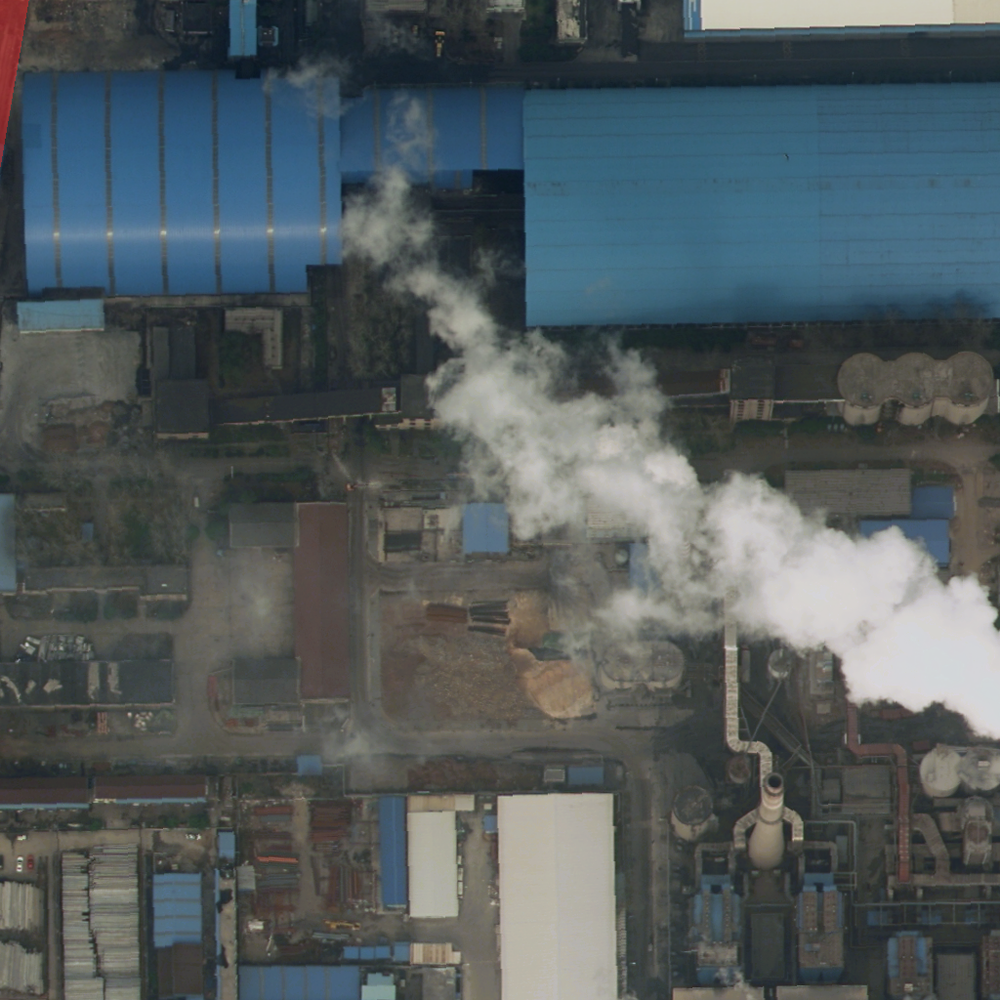
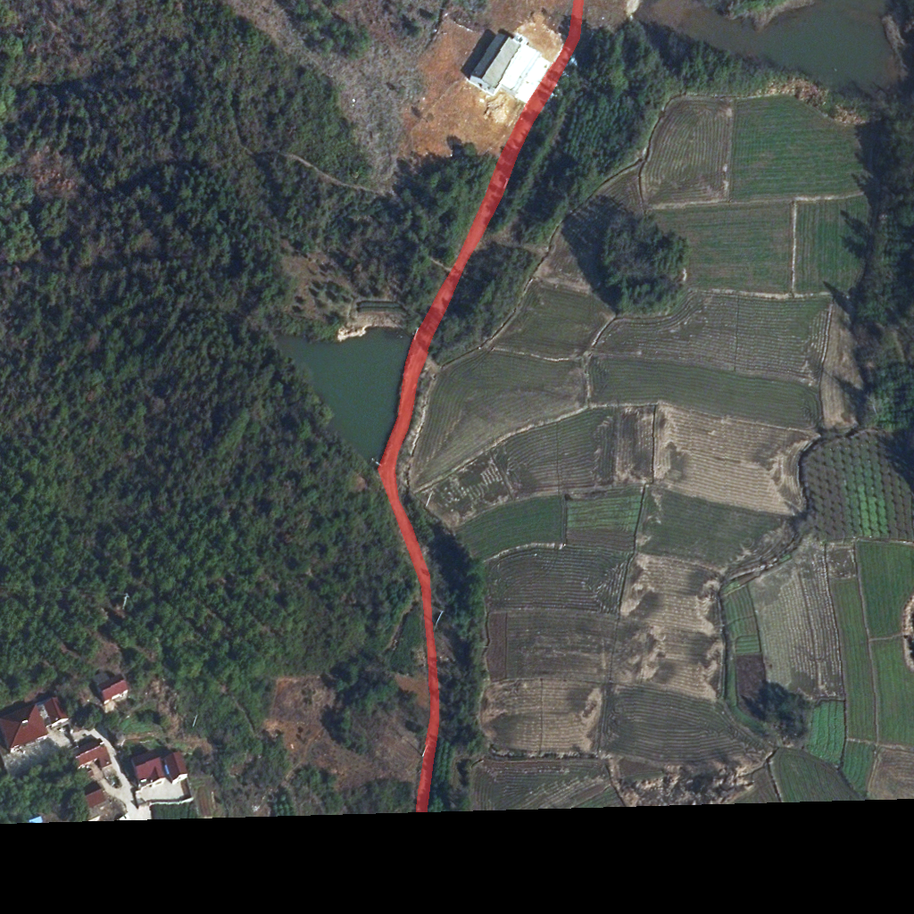
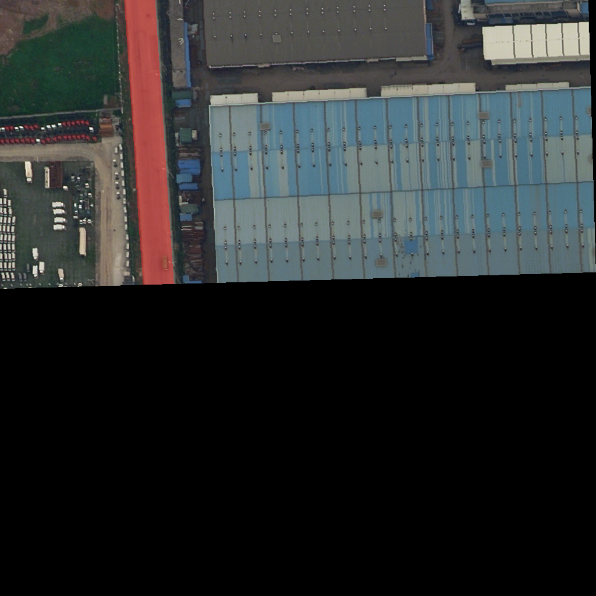
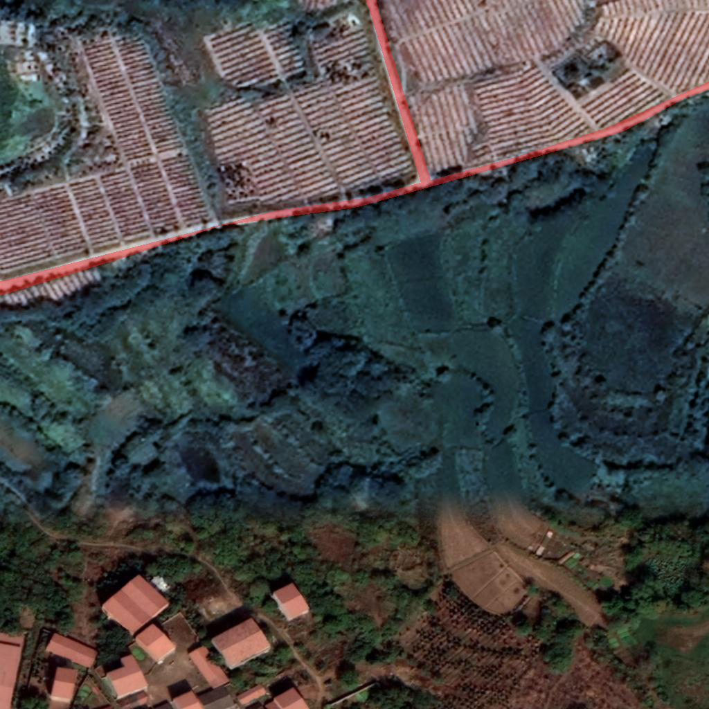

# Shared dataset audit

Seed: 523. CPU-only elapsed time: 394.14 seconds. Raw labels 0–7 were preserved; road=3, ignore=0.

Reproduce from the repository root after activating the existing environment:

```bash
python scripts/data_audit.py --seed 523 --sample-size 50
```

EC523_DATA_DIR must be set. Data were opened read-only with Pillow; no source data or masks were copied. Output PNGs are derived road overlays.

## Integrity (all images and masks)

| split | domain | images | masks | decoded_images | decoded_masks | valid_paired_masks | anomalies |
| --- | --- | --- | --- | --- | --- | --- | --- |
| Train | Urban | 1156 | 1156 | 1156 | 1156 | 1156 | 0 |
| Train | Rural | 1366 | 1366 | 1366 | 1366 | 1366 | 0 |
| Val | Urban | 677 | 677 | 677 | 677 | 677 | 0 |
| Val | Rural | 992 | 992 | 992 | 992 | 992 | 0 |

## Label proportions (all valid paired masks)

Fractions use all mask pixels; road_valid_fraction uses only nonzero labels. Invalid masks are excluded explicitly through integrity counts.

| split | domain | images | total_pixels | label_0_fraction | label_1_fraction | label_2_fraction | label_3_fraction | label_4_fraction | label_5_fraction | label_6_fraction | label_7_fraction | road_valid_fraction | ignore_fraction | no_road_images |
| --- | --- | --- | --- | --- | --- | --- | --- | --- | --- | --- | --- | --- | --- | --- |
| Train | Urban | 1156 | 1212153856 | 0.048175 | 0.461166 | 0.201791 | 0.088327 | 0.035519 | 0.072011 | 0.075353 | 0.017657 | 0.092797 | 0.048175 | 141 |
| Train | Rural | 1366 | 1432354816 | 0.028789 | 0.245543 | 0.025756 | 0.018888 | 0.083551 | 0.031738 | 0.221827 | 0.343908 | 0.019448 | 0.028789 | 486 |
| Val | Urban | 677 | 709885952 | 0.038782 | 0.249521 | 0.119974 | 0.074599 | 0.113531 | 0.052364 | 0.104517 | 0.246710 | 0.077609 | 0.038782 | 96 |
| Val | Rural | 992 | 1040187392 | 0.017541 | 0.421192 | 0.036184 | 0.025605 | 0.114377 | 0.035773 | 0.049434 | 0.299895 | 0.026062 | 0.017541 | 314 |

## Connected components (fixed random subset)

8-neighbor foreground connectivity. Sizes are in pixels; quantiles pool components rather than weighting images equally.

| split | domain | sampled_images | components_total | components_per_image_mean | component_size_min_px | component_size_median_px | component_size_p90_px | component_size_max_px |
| --- | --- | --- | --- | --- | --- | --- | --- | --- |
| Train | Urban | 50 | 90 | 1.800000 | 1.000000 | 16532.000000 | 121132.800000 | 457727.000000 |
| Train | Rural | 50 | 70 | 1.400000 | 1.000000 | 7610.500000 | 32879.700000 | 72137.000000 |
| Val | Urban | 50 | 92 | 1.840000 | 4.000000 | 15470.500000 | 123385.700000 | 325585.000000 |
| Val | Rural | 50 | 43 | 0.860000 | 28.000000 | 11179.000000 | 39084.400000 | 230271.000000 |

## Estimated road width distribution

Width = 2 * Euclidean distance to nearest background at each Zhang centerline pixel. Quantiles pool centerline pixels, weighting longer roads more. Pixel discretization and intersection interiors can inflate estimates; these are calibration proxies, not physical measurements.

| split | domain | skeleton_pixels | width_min_px | width_p10_px | width_p25_px | width_median_px | width_p75_px | width_p90_px | width_p95_px | width_max_px |
| --- | --- | --- | --- | --- | --- | --- | --- | --- | --- | --- |
| Train | Urban | 83103 | 2.000000 | 12.649111 | 18.000000 | 26.683329 | 53.814495 | 111.892807 | 142.000000 | 470.612366 |
| Train | Rural | 51537 | 2.000000 | 8.000000 | 10.000000 | 12.649111 | 17.088007 | 24.738634 | 34.058773 | 84.852814 |
| Val | Urban | 83405 | 2.000000 | 10.000000 | 15.231546 | 29.120440 | 79.624115 | 110.887329 | 120.000000 | 255.828064 |
| Val | Rural | 35449 | 2.000000 | 8.246211 | 10.770329 | 16.000000 | 29.529646 | 84.000000 | 113.218373 | 162.000000 |

## Centerline endpoints and junctions

Endpoints have exactly one foreground neighbor in the 8-neighbor skeleton graph. Junctions are 8-connected clusters of degree >=3 pixels; junction_pixels is also retained per image. Diagonal staircases, adjacent branches, image boundaries and ignored areas can affect these counts; they are not validated road-network nodes.

| split | domain | sampled_images | endpoints_per_image_mean | junction_clusters_per_image_mean |
| --- | --- | --- | --- | --- |
| Train | Urban | 50 | 4.800000 | 2.420000 |
| Train | Rural | 50 | 3.840000 | 1.180000 |
| Val | Urban | 50 | 7.800000 | 4.740000 |
| Val | Rural | 50 | 2.480000 | 0.800000 |

## Anomalies

No anomalies observed.

## Examples

The first road-containing filename in each sorted random subset supplies the example (last sample if all are road-free); red overlay marks raw road pixels. Exact sampled filenames and per-image statistics are in structure_samples.csv.

| Group | Derived overlay |
| --- | --- |
| Train/Urban |  |
| Train/Rural |  |
| Val/Urban |  |
| Val/Rural |  |

## Observations and calibration limits

- Observed Train/Urban: road/valid=9.28%, ignore=4.82%, no-road images=141/1156; sampled width median=26.68px, p90=111.89px.
- Observed Train/Rural: road/valid=1.94%, ignore=2.88%, no-road images=486/1366; sampled width median=12.65px, p90=24.74px.
- Observed Val/Urban: road/valid=7.76%, ignore=3.88%, no-road images=96/677; sampled width median=29.12px, p90=110.89px.
- Observed Val/Rural: road/valid=2.61%, ignore=1.75%, no-road images=314/992; sampled width median=16.00px, p90=84.00px.
Observed differences are descriptive. Width tails can include broad annotated regions and intersection geometry; inspect overlays before using them as synthetic road widths. Endpoints and components describe existing masks, not missing-road gap lengths. No artificial gap-length distribution was measured. The sample is fixed at 50 images per group and no uncertainty interval is estimated.
